<div align="center">


# GameVault — Digital Gaming Marketplace & Fulfillment Engine

**A production-oriented Laravel and Vue gaming marketplace demonstrating concurrency-safe checkout,
secure digital inventory and reliable asynchronous fulfillment.**

PHP 8.4 · Laravel 12 · Vue 3 · Inertia v2 · TypeScript · MySQL 8.4 · Redis 7.4 · Horizon · Pest · Playwright · k6

</div>

> [!NOTE]
> A portfolio project. All games are fictional, payment is **simulated**, keys are **synthetic**,
> and nothing is affiliated with a real store. The engineering is real: every claim below is backed
> by a check that was executed, and the results section says exactly which and when.

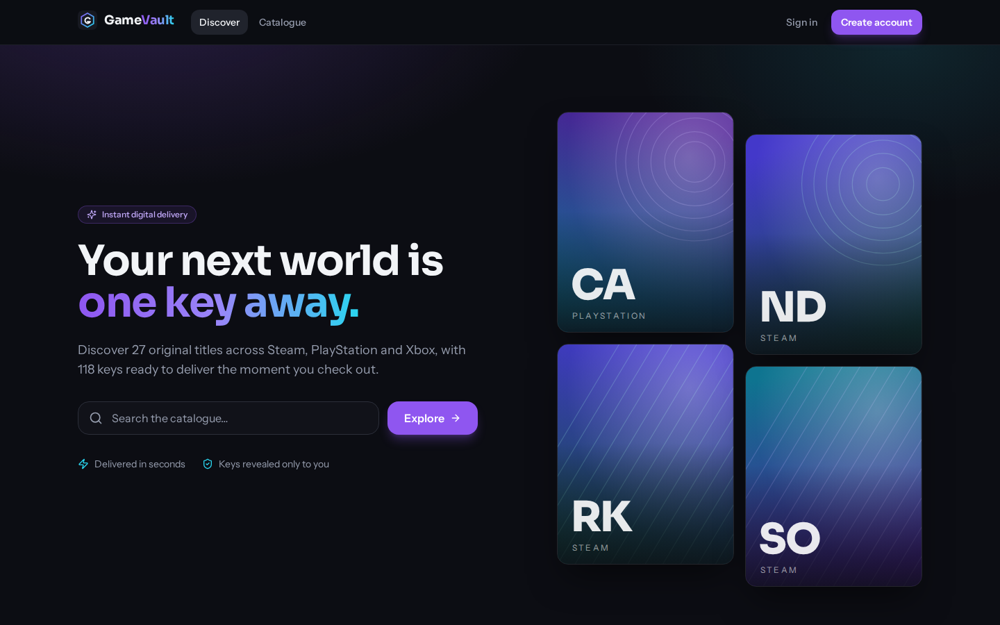

## Contents

[Screenshots](#application-screenshots) · [Stack](#technology-stack) · [Overview](#product-overview) ·
[Features](#features) · [Architecture](#system-architecture) · [Checkout](#checkout-sequence) ·
[Inventory](#inventory-consistency-design) · [Fulfillment](#queue-fulfillment-lifecycle) ·
[Outbox](#transactional-outbox-design) · [Security](#security-model) · [Frontend](#frontend-screenshots) ·
[Admin](#admin-screenshots) · [Setup](#local-development-setup) ·
[Demo](#demo-workflow) · [Testing](#testing) · [Results](#verified-results) · [CI](#ci-status) ·
[Performance](#performance-results) · [Trade-offs](#architecture-trade-offs) · [AI](#how-i-used-ai) ·
[Limitations](#known-limitations) · [Next](#future-improvements)

## Application screenshots

All screenshots are captured from the running application by `scripts/screenshots.sh`
(Playwright against the seeded E2E stack). Data is the deterministic E2E fixture set.

| Catalogue with server-side filters | Game detail |
| --- | --- |
| 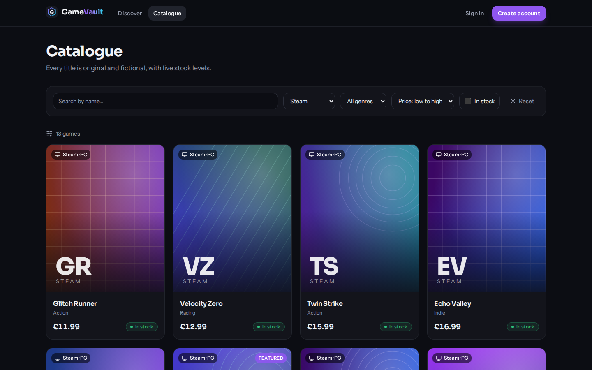 | 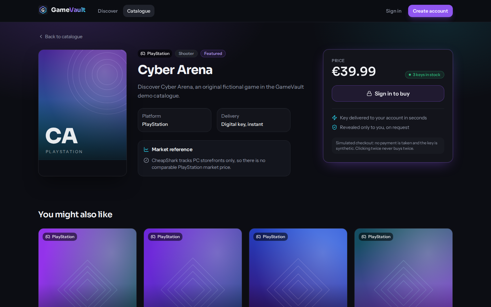 |

| Admin overview (live aggregates) | Delivered order, key revealed on request |
| --- | --- |
| 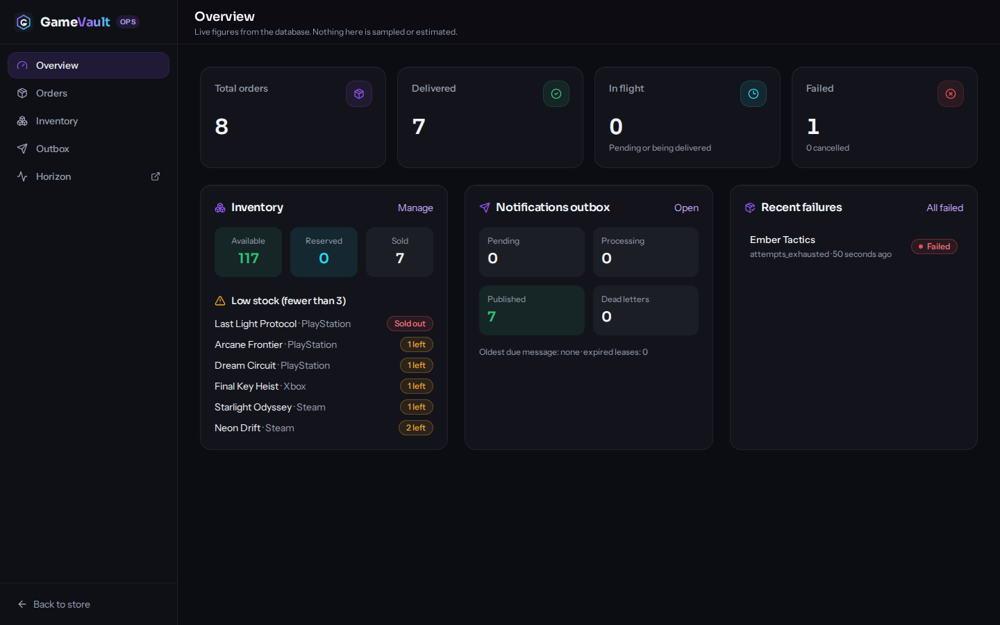 | 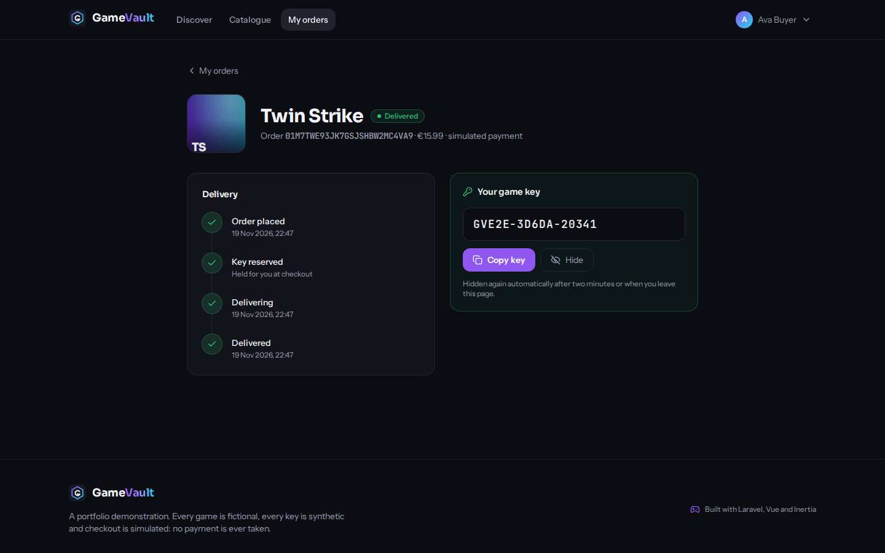 |

More in [Frontend screenshots](#frontend-screenshots) and [Admin screenshots](#admin-screenshots).

## Technology stack

| Layer | Technology (exact versions from the lock files) |
| --- | --- |
| Backend | PHP 8.4.27, Laravel 12.73, inertia-laravel 2.0.28, Horizon 5.52, Ziggy 2.7 |
| Data | MySQL 8.4.13 (InnoDB, READ COMMITTED), Redis 7.4 (queues, cache, Horizon) |
| Frontend | Vue 3.5 (`<script setup>`, strict TypeScript 5.7), @inertiajs/vue3 2.0 (deferred props, partial reloads), Vite 6.1, Tailwind CSS 3.4, radix-vue / shadcn-vue primitives, lucide icons |
| Quality | Pest 3.8, Larastan 3.15 (PHPStan 2.3, level 8), Pint 1.32, vue-tsc 2.2, ESLint 9.21, Prettier 3.5 |
| Testing | multi-process MySQL concurrency harness, Playwright 1.64.1 (E2E, Chromium), k6 2.3.0 (load) |
| Runtime | Docker Compose: app, MySQL, Redis, Horizon, scheduler; isolated E2E profile |

## Product overview

Customers browse a catalogue of original titles for Steam, PlayStation and Xbox, buy a key in a
simulated checkout and receive it seconds later through an asynchronous fulfillment pipeline. The
key is revealed only when the owner asks for it. Operators get an admin console for orders,
inventory, failed fulfillments and the notification outbox.

The difficult part is invisible on purpose: when many buyers want the last key at once, exactly
one gets it and nobody is told "sold out" while it could still be theirs; when a queue delivers a
job twice or a worker dies half-way, no key is delivered twice or lost; a notification is never
lost and never contains a secret.

## Features

**Storefront**
- Discover page with featured titles, a *Trending* section whose ranking rule is stated on the page (most purchases in the last 14 days; labelled fallback when there are none) and real stock counts
- Catalogue with server-side search, platform/genre filters, sorting, pagination and shareable URLs
- Game detail with stock state, related titles and a **market reference** from CheapShark, loaded as a deferred prop so an external API can never delay the page
- Honest market data: PC titles only, always with source, currency (USD), scope and fetch time; console titles say "not applicable" instead of showing a misleading number

**Checkout and orders**
- Simulated, idempotent checkout: one idempotency key per purchase intent, re-sent on double clicks, retries, lost responses and reloads; the client never sends a price
- Every outcome handled in the UI: created, replayed, sold out (409), validation (422), rate limited (429 with Retry-After), busy (503, retried with the same key), session expiry
- Order page with live fulfillment progress (bounded polling with backoff, paused in background tabs)
- Key reveal on explicit action only: kept in memory, auto-hidden after two minutes, cleared on navigation, never in web storage, copy button with fallback

**Admin console** (existing admin routes, server-side gate)
- Overview from live aggregates: orders, inventory, low stock, outbox health, recent failures
- Orders: search by order id or customer e-mail, status and failure filters, detail drawer, full timeline, inventory movements and audit trail; audited retry and cancel (with reason) behind confirmation dialogs
- Inventory: per-title available/reserved/sold counts, low-stock filter, synthetic key import with per-line validation feedback
- Outbox: status filters including "retrying", failure reasons, audited requeue of one or all dead letters; Horizon link

**Engine**
- Concurrency-safe inventory (`FOR UPDATE SKIP LOCKED` with a verified-stockout fallback), 17 CHECK constraints, composite foreign keys
- Fulfillment with leases and fencing tokens; bounded retries; recovery of stuck orders
- Transactional outbox with fenced claims, exponential backoff and dead letters
- Request IDs across HTTP, logs, jobs and audit entries; owner-only policies (404 for others)

## System architecture

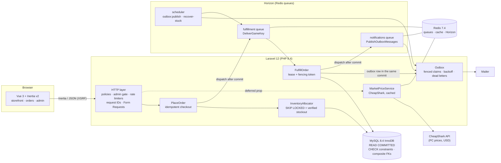

Deeper write-up of every guarantee and how it is enforced: [docs/architecture.md](docs/architecture.md).
The key decisions are recorded as [architecture decision records](docs/adr/README.md).

## Checkout sequence

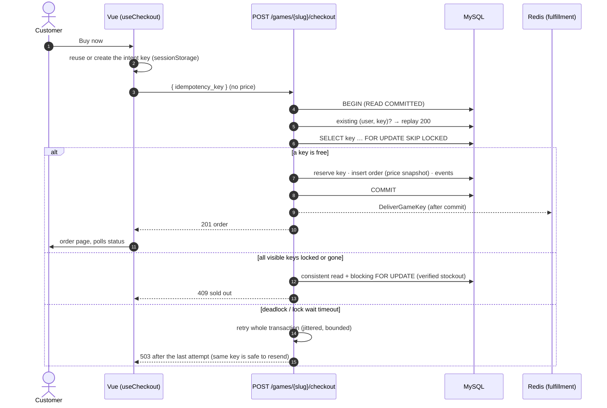

## Inventory consistency design

- **One intent, one order.** `UNIQUE(user_id, idempotency_key)` plus a request fingerprint: a replay returns the committed order (200), a reused key for a different game is a 422, never a second purchase.
- **Reservation without false stockouts.** Buyers take a free key with `FOR UPDATE SKIP LOCKED`, so they do not queue behind each other. Skipping locked rows can make a buyer *believe* stock is gone while another buyer's transaction might still roll back, so "sold out" is only answered after a verified stockout (consistent read, then a blocking `FOR UPDATE`): nobody is told "sold out" while a key could still become theirs.
- **Isolation and plans.** READ COMMITTED (no gap locks on the hot path), a 5 s lock-wait timeout, index-pinned locking reads, and whole-transaction retries with jitter; exhaustion is a retryable 503.
- **The database has the last word.** 17 CHECK constraints and composite foreign keys reject impossible states (a sold key without an order, an order holding another title's key, ...), independently of application code.
- **Proven with real processes.** The concurrency tests start independent PHP processes, each with its own MySQL connection, release them through a barrier and assert commit ordering, not timing. The load test below repeats the race over HTTP and then checks the database.

## Queue fulfillment lifecycle

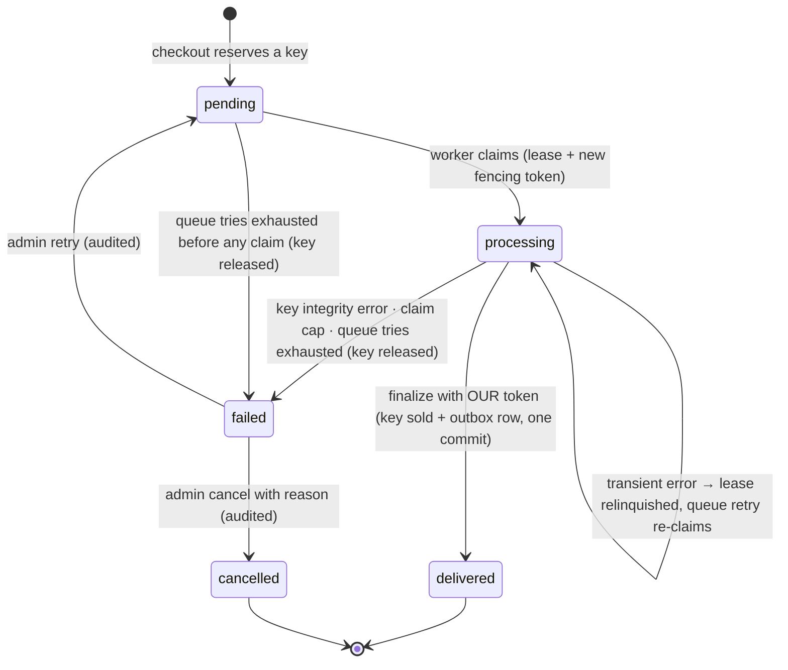

Three short steps, so no transaction is ever open during slow work: **claim** (lock the order,
take a lease with a fresh fencing token), **provision** (no transaction; the supplier hand-off),
**finalize** (only if the order still carries *our* token). A duplicate job is a no-op, a crashed
worker's lease expires and is taken over, and a slow worker that lost its lease cannot finalize.
`DeliverGameKey` retries transient failures 5 times with backoff 5/15/45/135 s; its timeout (30 s)
stays below the lease (60 s), which stays below the queue's `retry_after` (90 s), an invariant
pinned by a unit test.

## Transactional outbox design

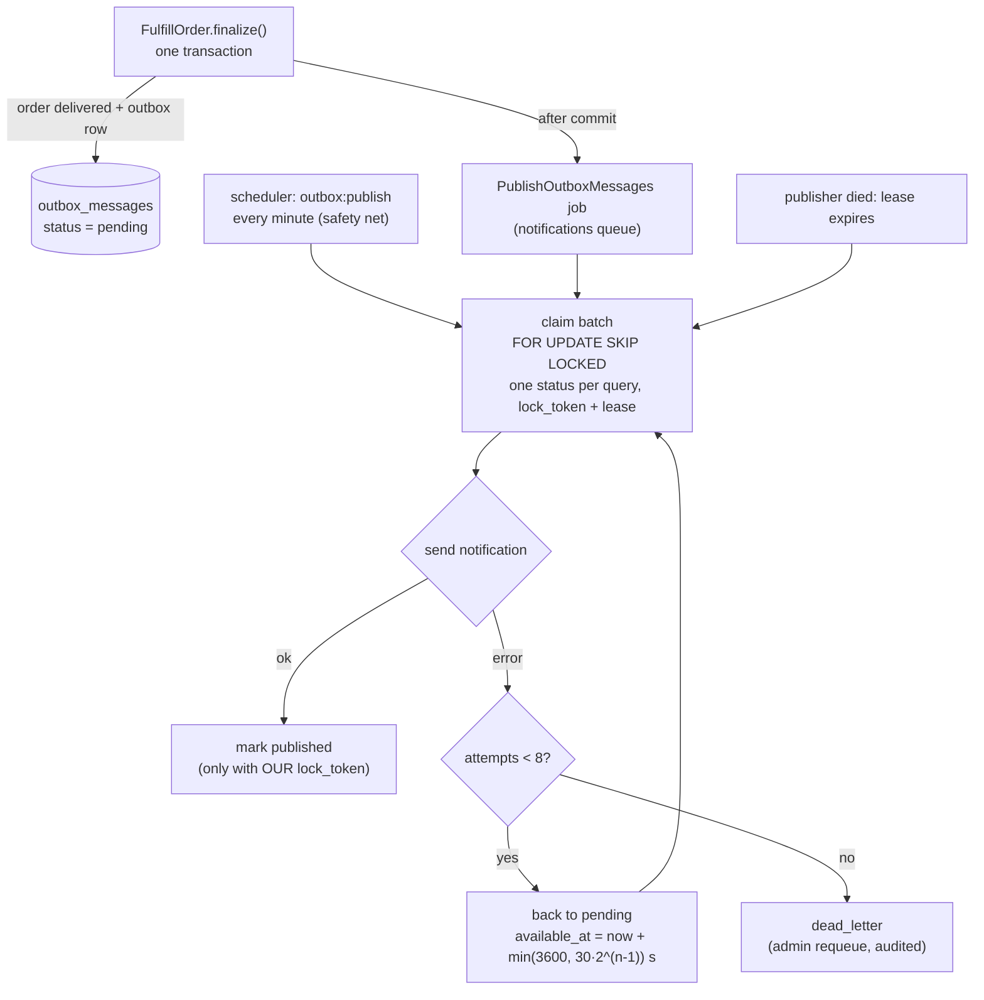

The delivery e-mail is written in the same commit as the delivery itself, so it can never be lost
or sent for a delivery that rolled back. Delivery to the mailer is at-least-once; the e-mail
contains no key material, only a link to the order.

## Security model

- **Authorization on the server.** Customer order routes are owner-only and answer **404** to anyone else; public ids are ULIDs. The admin area requires `auth` + `can:admin` on every route; Horizon is admin-only in every environment. Admins can retry, cancel, import and requeue, but can **never** reveal a customer's key. The E2E suite also sends crafted requests to prove the UI is not the only barrier.
- **Keys.** Encrypted at rest, fingerprinted for de-duplication, revealed only by an owner's explicit POST (CSRF-protected, rate limited, audited, `no-store`), never placed in Inertia props, listings, e-mails, logs or web storage. A live scan after the E2E and Horizon runs searched every log, failed job, Horizon payload, audit entry, order event and outbox payload for all 124 keys: none found.
- **No privilege escalation.** `is_admin`, status, lease and key linkage are not mass-assignable (strict mode outside production); admin rights are granted only via CLI and audited.
- **Abuse limits.** Checkout and reveal are rate limited per user; the UI explains the wait using `Retry-After`.
- **Errors.** Branded error pages keep the right status; with debug off, 500s expose nothing but a request id. No `v-html` anywhere.
- **Test isolation.** The Pest suite refuses any database but `gamevault_test`; the E2E stack refuses any database not ending in `_e2e` (checked at boot and before `migrate:fresh`).

## Frontend screenshots

| My orders | Mobile storefront |
| --- | --- |
| 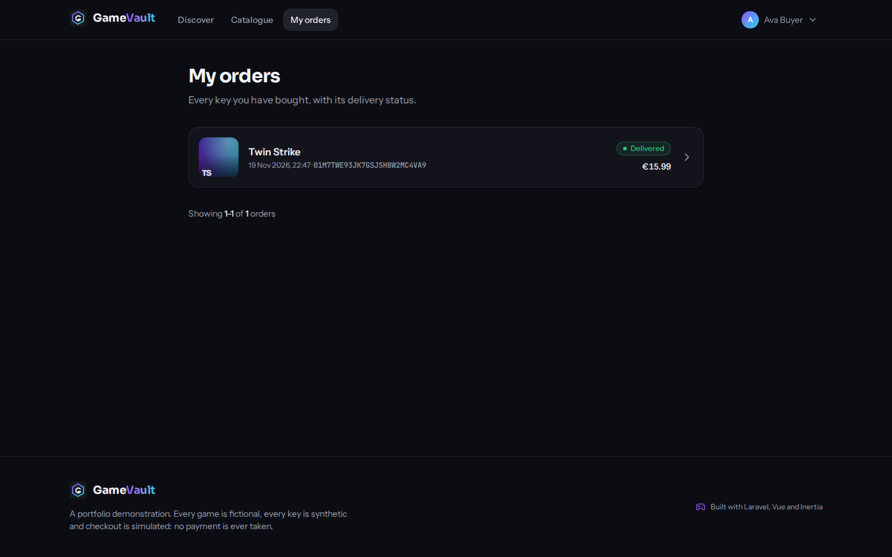 | 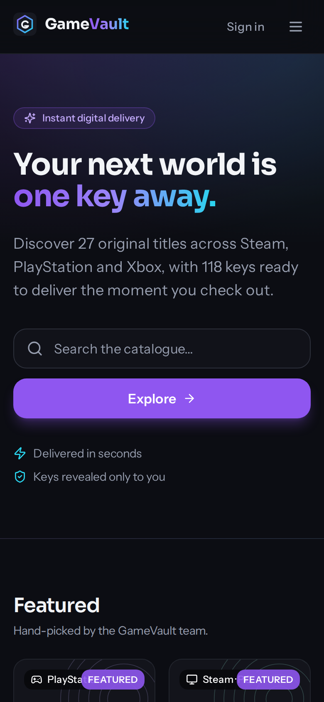 |

The game detail above shows a console title: CheapShark only covers PC storefronts, so the market
card says so instead of showing a number. (The E2E stack replaces CheapShark with a local stub, so
no screenshot here shows third-party prices.)

## Admin screenshots

| Failed order in the detail drawer | Inventory with key import |
| --- | --- |
| 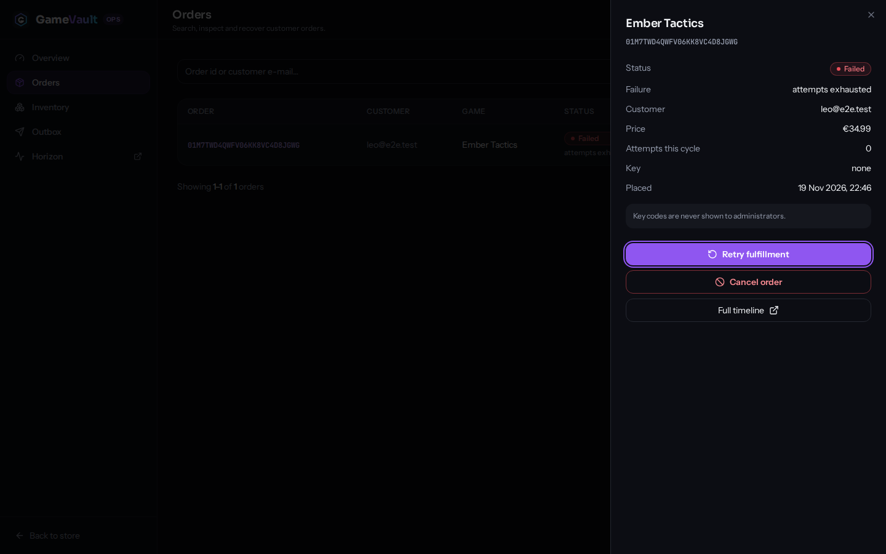 | 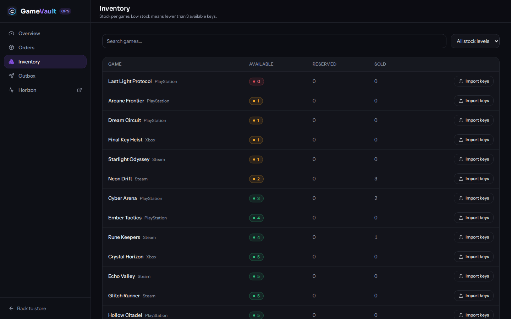 |

| Outbox |
| --- |
| 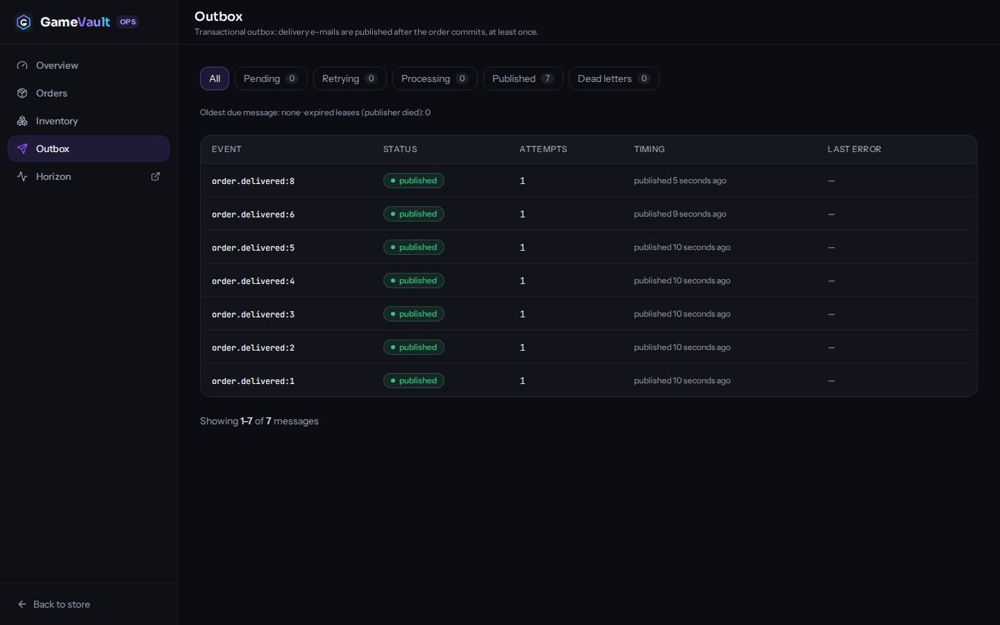 |

## Local development setup

Requirements: Docker with Compose v2. Everything (PHP, Composer, Node) runs in containers.

```bash
cp .env.example .env
docker compose up -d mysql redis
docker compose run --rm app composer install
docker compose run --rm app php artisan key:generate
docker compose run --rm app php artisan migrate
docker compose run --rm app php artisan db:seed --class=GameVaultSeeder   # fictional catalogue + synthetic keys
docker compose run --rm app npm ci
docker compose run --rm app npm run build
docker compose up -d app                                 # http://localhost:8000
docker compose --profile workers up -d                   # Horizon + scheduler (fulfillment, outbox, recovery)
docker compose run --rm app php artisan gamevault:admin you@example.com   # admin rights (CLI only, audited)
```

## Demo workflow

1. Register an account and open **Discover**; note the stated trending rule.
2. Search or filter the **Catalogue**; the URL reproduces the result.
3. Open a game: console titles show the "not applicable" market state; the fictional Steam titles have no CheapShark listing and say so. Set a real CheapShark game id in a title's `cheapshark_id` to see a live PC reference with source, currency and fetch time.
4. **Buy now · simulated**. Double-click it: still one order.
5. Watch the order move from *Queued* to *Delivering* to *Delivered* (Horizon must be running), then **Reveal key** and **Copy**. Leave the page: the key is gone from the screen.
6. Grant yourself admin rights (command above) and open **Admin**: live figures, the order you just placed, its timeline and audit trail.
7. Simulate a supplier outage and watch retries and the failed job in Horizon, then retry the order from the admin console:
   ```bash
   docker compose run --rm app php artisan gamevault:supplier-outage on    # non-production only, expires on its own
   docker compose run --rm app php artisan gamevault:supplier-outage off
   ```

## Testing

```bash
# Backend: Pest on MySQL 8.4 (Unit, Feature, Integration incl. multi-process concurrency)
docker compose run --rm app php artisan test
docker compose run --rm app vendor/bin/pint --test
docker compose run --rm app vendor/bin/phpstan analyse --memory-limit=1G
docker compose run --rm --no-deps app composer validate --strict

# Frontend
docker compose run --rm --no-deps app npm run typecheck      # vue-tsc (strict) + Playwright sources
docker compose run --rm --no-deps app npm run lint:check
docker compose run --rm --no-deps app npm run format:check
docker compose run --rm --no-deps app npm run build

# Real stack (isolated E2E profile: gamevault_e2e database, Redis DBs 2/3, own logs)
scripts/e2e.sh                 # 20 Playwright journeys, see e2e/README.md
E2E_KEEP_RUNNING=1 scripts/e2e.sh && scripts/verify-horizon.sh   # live Redis/Horizon checks
scripts/loadtest.sh            # k6 scenarios + database correctness checks
scripts/screenshots.sh         # regenerates docs/screenshots
```

## Verified results

Runs of 2026-11-22 on Docker Desktop (Windows 10 host, 8 CPUs and 31 GiB for Docker) with PHP
8.4.27, MySQL 8.4.13 and Redis 7.4:

| Check | Command | Result |
| --- | --- | --- |
| Composer | `composer validate --strict` | valid |
| Code style | `vendor/bin/pint --test` | passed, 172 files |
| Static analysis | `vendor/bin/phpstan analyse` (Larastan, level 8) | no errors |
| Backend tests | `php artisan test` on MySQL 8.4 | **332 passed**, 0 failed, 0 skipped (1,891 assertions, 283 s): Unit 13, Feature 260, Integration 59 |
| Concurrency (included above) | `tests/Integration/Concurrency` | 18 passed: checkout 8, fulfillment 6, outbox 4, each with independent PHP processes on real MySQL |
| Backend tests as in CI | same suite with Redis unreachable and the phpredis extension unloaded | 330 passed, 0 failed (run before the two recovery tests below were added) |
| Types | `npm run typecheck` (vue-tsc and the Playwright sources) | 0 errors |
| Lint and format | `npm run lint:check`, `npm run format:check` | clean |
| Production build | `npm run build` | built |
| E2E | `scripts/e2e.sh` (Playwright 1.64.1, Chromium) | 21 passed (20 journeys and the link check), 0 failed, 0 flaky, retries disabled |
| Live Redis/Horizon | `scripts/verify-horizon.sh` | 14 of 14 checks passed (the run before the fix below: 12 of 14) |
| Key leak scan | `gamevault:scan-key-leaks` after the E2E and Horizon runs | 124 keys checked in logs, failed jobs, Horizon payloads, audit entries, order events and outbox: none found |
| Schema | `information_schema` after a fresh migration | 17 CHECK constraints |

**What the live checks caught.** During a simulated supplier outage, the scheduled
`gamevault:recover-stuck` sweep re-dispatched an order whose queue retry was still waiting out its
backoff, so the order was attempted 7 times instead of 5 and its retries ran ahead of the backoff
schedule. Recovery now waits `stuck_after_minutes` after a lease expired before it takes over; a
regression test that fails without the fix is part of the backend results above. The E2E, live
Horizon and key-scan figures in the table come from runs on the fixed code: the job was attempted
exactly 5 times, with gaps of 8.3, 16.6, 46.3 and 136.5 s against the configured 5, 15, 45 and
135 s (each gap includes the 1.2 s simulated supplier call and the worker pickup), and two recovery
sweeps forced into the backoff window re-dispatched nothing. A first E2E run after the fix lost one
journey to a 90-second freeze of the local Docker VM; the rerun passed. CI runs the E2E suite and
the live checks on every push (see below).

## CI status

`.github/workflows/ci.yml` defines three parallel jobs, all check-only (no fixer steps that
always pass): **backend** (Composer validate, Pint, Larastan, full Pest suite on a MySQL 8.4
service including the concurrency tests), **frontend** (vue-tsc, ESLint, Prettier, production
build) and **e2e** (the Docker E2E stack, the 20 Playwright journeys, then the live Horizon checks;
reports and logs uploaded as artifacts).

[](https://github.com/KrzakLara/GameVault/actions/workflows/ci.yml?query=branch%3Amain)

The badge shows the outcome of the latest run on `main`; every run, with its logs and the uploaded
E2E reports, is public under [Actions](https://github.com/KrzakLara/GameVault/actions/workflows/ci.yml).
This README does not state a CI result of its own: the figures in [Verified results](#verified-results)
come from the local runs described there.

## Performance results

No load-test figures are published yet. The k6 scenarios in [loadtest/k6](loadtest/k6)
(storefront browsing and search, a checkout burst with order-status polling, and a last-keys
contention race) run with `scripts/loadtest.sh` against the isolated E2E stack only, and finish
with a database check for oversold or double-allocated keys. Results are written to
`loadtest/results/`.

## Architecture trade-offs

The main ones are written up with their context and consequences in [docs/adr](docs/adr/README.md).

- **Synchronous reservation, asynchronous delivery.** The key is reserved inside the checkout transaction, so "you got it" is decided once, at checkout; only delivery is queued. Cost: checkout holds row locks briefly and needs the stockout verification path.
- **SKIP LOCKED plus verification instead of plain `FOR UPDATE`.** Buyers do not serialise on the first free row, at the price of a second, rarer query when stock looks empty.
- **READ COMMITTED.** Avoids gap-lock deadlocks of REPEATABLE READ on the hot path; correctness comes from explicit row locks and constraints, not from the isolation level.
- **Leases and fencing over "exactly once".** Queues are at-least-once; the business operation is made idempotent instead of trusting the transport.
- **Outbox over "send after commit".** One extra table and a publisher, in exchange for never losing or inventing a notification.
- **Polling over WebSockets.** Bounded, visibility-aware polling of one order is simple and cheap at this scale; push would be the next step under real traffic.
- **Inertia over a separate SPA + API.** One routing and authorization layer, typed props mirrored by `types/models.ts` and pinned by `FrontendContractTest`.
- **Dark-only design.** One carefully tuned theme instead of two half-finished ones.

## How I used AI

This repository was built with an AI coding assistant (Claude Code, Anthropic) working as the
implementing engineer on written specifications from the repository owner: the owner defined the
goals, phases and non-negotiable constraints (no fabricated results, real MySQL for concurrency
claims, isolated test environments, no pushes), and the assistant wrote the code, tests, scripts
and documentation, and ran every check.

What keeps that honest:
- **Every claim is tied to an executed check.** Test counts, E2E results, Horizon checks and load-test numbers in this README were copied from real runs; failures found on the way (for example a selector that matched the wrong element, or `artisan serve` silently dropping the E2E database setting) were fixed and re-run, not hidden.
- **Verification is automated and reproducible.** Anyone can re-run every result with the commands above.
- **No invented review.** This README does not claim a human code review, security audit or production deployment that did not happen. Review the code before relying on it.

## Known limitations

- Payment and supplier are simulated (`SimulatedKeyProvisioner` waits and can fake an outage); there is no real payment provider or key supplier.
- The delivery e-mail is at-least-once; a duplicate e-mail is possible after a publisher crash, a lost one is not.
- `APP_KEY` rotation requires re-encrypting keys and recomputing fingerprints.
- Leases rely on synchronised clocks across hosts.
- CheapShark prices are USD for PC storefronts and are not comparable with the EUR catalogue prices.
- The local and E2E app server is `php artisan serve` (PHP's built-in server); load numbers describe that setup, not a tuned production deployment.
- The E2E suite runs in Chromium only.

## Future improvements

- Real payment (provider sandbox) with webhooks feeding the same idempotent checkout
- Push updates for order status (Laravel Reverb) instead of polling
- Production container image (PHP-FPM or FrankenPHP/Octane) and load tests against it
- Key rotation tooling (re-encryption, fingerprint migration)
- Cross-browser E2E (Firefox, WebKit) and visual regression snapshots
- Per-title supplier adapters behind `KeyProvisioner`
