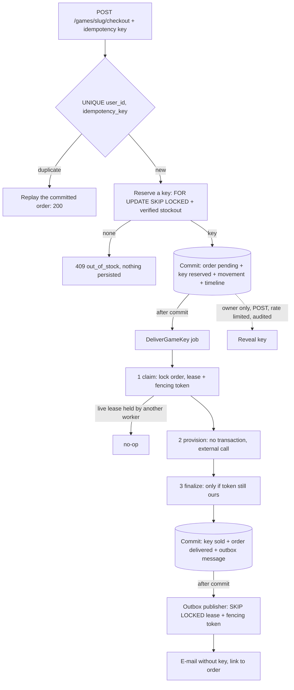

# Architecture and guarantees

GameVault sells synthetic game keys. The hard problem is the backend: two buyers racing for the
last key, queue jobs delivered twice, workers that crash half-way, and notifications that must
never be lost or contain secrets. This document states what is guaranteed, how, and how it is
verified. Everything below is exercised by the test suite on MySQL 8.4 (see "Verification").

## Guarantees and where they are enforced

| Guarantee | Mechanism | Enforced by |
|---|---|---|
| A key is sold at most once; an order owns at most one key | Row locks; `UNIQUE(game_keys.order_id)`; CHECK status/order agreement | MySQL |
| A key only belongs to an order of the same game | Composite FK `(order_id, game_id) -> orders(id, game_id)` | MySQL |
| No impossible order/key/outbox state (e.g. delivered without timestamp, processing without lease, failed without reason) | 17 CHECK constraints | MySQL |
| One logical order per (user, idempotency key) | `UNIQUE(user_id, idempotency_key)`; request fingerprint | MySQL + `PlaceOrder` |
| Price is never client-controlled | Snapshot from the locked `games` row inside the checkout transaction | `PlaceOrder` |
| "Sold out" is never reported while a key may still become free | SKIP LOCKED fast path + verified-stockout fallback | `InventoryAllocator` |
| Exactly one delivery per order under duplicate/concurrent jobs | Lease + fencing token; state machine | `FulfillOrder` |
| A stale worker can never finalize or fail an order it no longer owns | Fencing token checked under the order row lock | `FulfillOrder`, `FailOrder` |
| No external call inside a database transaction | Provisioning runs between two committed steps | `FulfillOrder` + tests |
| Business state and its event commit atomically; nothing is published for uncommitted state | Outbox row written in the same transaction; publisher dispatched after commit | `Outbox` |
| A message is never claimed by two live publishers; a stale publisher cannot overwrite a newer outcome | SKIP LOCKED claim with lease; fenced conditional updates | `OutboxPublisher` |
| Keys never leave the system except to their owner | Encrypted at rest; hidden from serialisation; whitelisted resources; owner-only POST reveal | Models, resources, `OrderPolicy` |

## Checkout and idempotency

* The client sends an idempotency key (body field `idempotency_key` or `Idempotency-Key` header,
  16-64 chars `[A-Za-z0-9_-]`). The browser page creates one per page view.
* The **database** is the arbiter: identical requests that race all INSERT the same
  `(user_id, idempotency_key)`. InnoDB makes the later INSERTs wait on the first one's index entry;
  when it commits they fail with a duplicate-key error and replay the committed order. The initial
  `SELECT` is only a fast path for retries of a finished request.
* Same key, different payload (another game) is rejected with `422 idempotency_conflict`.
* Only an **accepted** checkout consumes its key. A rejected one (sold out, inactive game, rolled
  back) leaves no row, so retrying it with the same key is safe and may succeed later.
* Responses: `201` + `Location` (new), `200` + `Idempotent-Replayed: true` (replay), `409
  out_of_stock`, `404 unavailable`, `422`, `429`, and `503 temporarily_unavailable` with
  `Retry-After` when lock contention outlasts the bounded retries (retrying is safe).

## Reservation protocol (SKIP LOCKED and false stockouts)

`SELECT ... WHERE game_id = ? AND status = 'available' ORDER BY id LIMIT 1 FOR UPDATE SKIP LOCKED`
lets concurrent buyers take **different** keys without queueing on the same row. Its weakness: if
the only remaining keys are locked by transactions that will roll back (a failing checkout, a
deadlock victim), SKIP LOCKED returns nothing and a naive allocator answers "sold out" although a
key is about to be free again. The multi-process tests measured exactly that on the original code.

The allocator therefore only reports a stockout when it is true:

1. SKIP LOCKED fast path: take any unlocked key.
2. If none: a plain read of committed data. If no key is `available`, the game is sold out.
3. Otherwise wait on the locks (plain `FOR UPDATE`, bounded by `innodb_lock_wait_timeout`). If the
   holders commit, their keys no longer match: true stockout. If one rolls back, take its key.

The wait cannot deadlock: key holders never wait for waiters (waiters hold no key locks), and every
code path takes locks in the same order (games shared, then orders, then game_keys).

The query is pinned to the `(game_id, status, id)` index (`FORCE INDEX`) so it walks keys in id
order and locks at most the row it returns. Without the hint, stale optimizer statistics (for
example computed before stock was imported) made MySQL leave that index; a plan with a filesort
would read, and lock, every matching row before `LIMIT` applies. A plan-guard test EXPLAINs the
real SQL under statistics frozen on an empty table.

## Isolation level

The MySQL connection runs **READ COMMITTED** (`DB_ISOLATION_LEVEL`) with `innodb_lock_wait_timeout
= 5` s (`DB_LOCK_WAIT_TIMEOUT`).

* Measured with 20 concurrent processes: under REPEATABLE READ the original allocator deadlocked
  (2 of 20 checkouts failed with error 1213 after retries) and sold 3 of 5 keys while telling 15
  buyers "sold out". With the new allocator, REPEATABLE READ still produced deadlock retries
  (next-key locks of the waiting scan vs. index inserts of the reserver); READ COMMITTED produced
  none. Correct outcomes were reached under both, thanks to the retry helper.
* No decision relies on snapshot reads: every decision is taken under an explicit row lock or is
  re-validated under one, and duplicate-key checking (the idempotency arbiter) still locks under
  READ COMMITTED.
* Deadlocks and lock-wait timeouts are retried as whole transactions with jittered backoff
  (`App\Support\Transactions::retrying`); exhaustion surfaces as a retryable 503.

## Fulfillment: leases, fencing, recovery

`claim` (transaction) -> `provision` (no transaction) -> `finalize` (transaction).

* **Lease**: `claim` sets `lease_token` (fresh ULID) and `lease_expires_at`. While the lease is live,
  other executions return `Busy` and do nothing, so duplicate jobs never provision concurrently.
* **Takeover**: an expired lease (crashed or hung worker) is taken over with a **new** token.
* **Fencing**: `finalize` and a worker's own failure are conditional on the order still carrying
  the worker's token. A slow worker whose lease was taken over gets `Superseded` and changes
  nothing. A worker whose lease expired but was not taken over still holds the current token and
  may finish (nobody else did any work).
* **Transient errors**: the worker relinquishes its lease before rethrowing, so the queue retry can
  take over immediately. Backoff 5 s, 15 s, 45 s, 135 s; 5 tries.
* **Timing invariant** (asserted by tests): job timeout 30 s < lease 60 s < queue `retry_after`
  90 s. A live worker never outlives its lease; a job redelivered after a crash always finds the
  dead worker's lease already expired.
* **Bounded reservation lifetime**: `attempts` counts claims per fulfillment cycle; at
  `max_attempts` (10) the order fails with `attempts_exhausted` and its key returns to stock.
  `gamevault:recover-stuck` (every 5 min) re-dispatches lost pending orders and expired leases.
* **Broken ciphertext** fails with `key_integrity` and the key stays quarantined (reserved against
  the failed order), never resold. Admins can cancel such orders; retry is refused.

| Crash point | Result | Recovery |
|---|---|---|
| Inside checkout transaction | Full rollback, no job, idempotency key not consumed | Client retries the same request |
| After checkout commit, before the job is queued | Order pending with reserved key | `recover-stuck` after 10 min |
| After `claim`, during provisioning (SIGKILL tested) | Order processing, key still reserved | Queue redelivery / `recover-stuck` after lease expiry: takeover |
| Inside `finalize` | Full rollback (key stays reserved, no outbox row) | Retry takes over |
| After `finalize` commit | Delivered; outbox row committed with it | Publisher (job or scheduled sweep) |

## Transactional outbox

* `Outbox::record()` writes the message in the business transaction (refuses to run outside one),
  inside a savepoint so a duplicate event id is a no-op without undoing the caller's work. Payloads
  are identifiers only (enforced): consumers load current data themselves.
* `OutboxPublisher` claims due messages with `FOR UPDATE SKIP LOCKED`, one status per query and
  pinned to the `(status, available_at)` index (`FORCE INDEX`), so the index is walked in order and
  a claim locks only the rows it returns. Both measures come from measurements: a combined
  `status IN (...)` query needed a filesort, and with stale statistics (computed on an empty table
  before a burst) MySQL chose a full scan + filesort even for one status. Either way the first
  publisher locked the whole backlog and the others claimed nothing (5 of 6 in one full-suite
  run). A plan-guard test EXPLAINs the real claim SQL under frozen empty-table statistics. A claim
  sets a lease and a fencing token; completion and failure are conditional on the token, so a
  publisher whose lease expired cannot overwrite the newer outcome.
* Retries: exponential backoff 30 s, 60 s, 120 s ... capped at 1 h; after 8 attempts the message is
  `dead_letter` (operator requeue via admin UI or `outbox:publish --requeue-dead-letters`, audited).
* Observability: every transition is logged (`outbox.recorded/claimed/published/retry_scheduled/
  dead_lettered/reclaimed_expired_lease/stale_completion_ignored`), `outbox:status [--json]` and the
  admin outbox page show counts per status, the oldest due message and expired leases.
* **Delivery semantics: at-least-once.** If a publisher dies after the side effect (e-mail sent)
  but before marking the message published, the message is delivered again after its lease
  expires (tested with SIGKILL). Exactly-once delivery to an external system is impossible without
  the receiver's cooperation (e.g. deduplicating on `event_id`). Business state is never changed by
  the publisher, so redelivery cannot duplicate a sale; the e-mail itself may rarely be sent twice.

## Security model

* Customer order routes are owner-only; non-owners get **404** (existence is not confirmed). URLs use
  ULIDs. Admin area: `auth` + `can:admin` on every route, re-checked in Form Requests. Admins can
  retry/cancel/import/requeue but never reveal a customer's key. Horizon is admin-only in every
  environment (its default would open it to everyone when `APP_ENV=local`).
* `is_admin`, order status, lease and key linkage are never mass-assignable; outside production
  Eloquent strict mode turns such attempts into exceptions. Admin rights only via
  `php artisan gamevault:admin <email>` (audited).
* Key reveal: POST (CSRF-protected), owner-only, delivered orders only, rate limited, audited,
  `Cache-Control: no-store`. Checkout is rate limited per user.
* Every response carries `X-Request-Id` (validated upstream id or a ULID); it is attached to logs,
  propagated into queued jobs, stored with audit entries and included in JSON error bodies.
* Errors: stable machine codes for domain errors; generic bodies for unexpected ones (no SQL or
  traces with `APP_DEBUG=false`); key codes are never flashed back after validation errors.
* Audited: key reveals, retries, cancellations (with reason), imports (counts only), outbox
  requeues, admin grants. Audit entries never contain key material.

## Verification

All tests run in Docker against MySQL 8.4 (`gamevault_test`; the suite refuses any other database).

* `tests/Integration/Concurrency`: **independent OS processes**, each booting Laravel with its own
  MySQL connection (checkouts go through the full HTTP kernel), released by a file barrier.
  Test-only hooks hold the application's own locks so every transaction is provably in flight at
  once; results record commit times, so "losers answered only after the winner committed" is an
  ordering assertion, not a timing guess. Includes real `artisan queue:work` processes, SIGKILLed
  workers and publishers, a genuine InnoDB deadlock, and lock-wait timeouts. Where a test must
  arrange database state first (hold a lock, let a lease expire), workers are *staged*: booted and
  parked at the barrier before the state is set up, so process start-up time (seconds, under load)
  never falls inside a race window. An earlier version without staging failed twice in a full
  run under load; that is why staging exists.
* `tests/Integration/Database`: every CHECK/UNIQUE/FK rejects a raw invalid write; migrations are
  rolled back and re-applied to an identical schema, and an overlay-era database populated with
  legacy rows is upgraded, used, rolled back and upgraded again without data loss.
* After every concurrency test, `Tests\Support\Invariants` replays the whole inventory ledger and
  checks key/order/outbox consistency with SQL.

## Known limitations

* Payment is simulated; there is no real supplier API (`SimulatedKeyProvisioner` waits, and in
  non-production environments can simulate an outage: `php artisan gamevault:supplier-outage on`).
* The delivery e-mail is at-least-once (see above).
* APP_KEY rotation requires re-encrypting keys and recomputing fingerprints (keyed with APP_KEY).
* Leases use the application clock; multi-host deployments need NTP-synchronised clocks (the
  lease is far longer than realistic skew).
* The CheapShark reference price is USD and not comparable with EUR catalogue prices.
