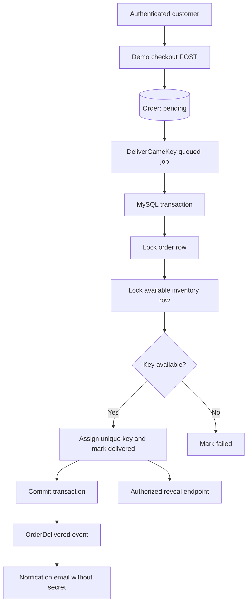

# Architecture and guarantees

## Design decisions
- `lockForUpdate` is meaningful on MySQL/InnoDB, not a proof of actual simultaneous-request safety by itself.
- A unique `game_keys.order_id` constraint prevents accidentally assigning two keys to the same order. One key is one row and owns only one `order_id`.
- The worker locks the order before the inventory; repeated delivery is idempotent.
- Transaction retries address deadlocks. Notification is emitted after commit, but app-level mail delivery isn't exactly-once; production needs an outbox/deduplication strategy.
- This MVP does not reserve inventory upon checkout and does not process real money. Orders may fail when stock is exhausted.
- We do **not** claim a concurrency stress test passed: a separate MySQL multi-process test is required before claiming verified concurrency guarantees.
- Market reference from CheapShark uses USD while the local catalog uses EUR; do not show these as like-for-like prices.
- Key ciphertext is produced via Laravel's encrypted attribute cast; APP_KEY rotation requires an explicit re-encryption strategy.
