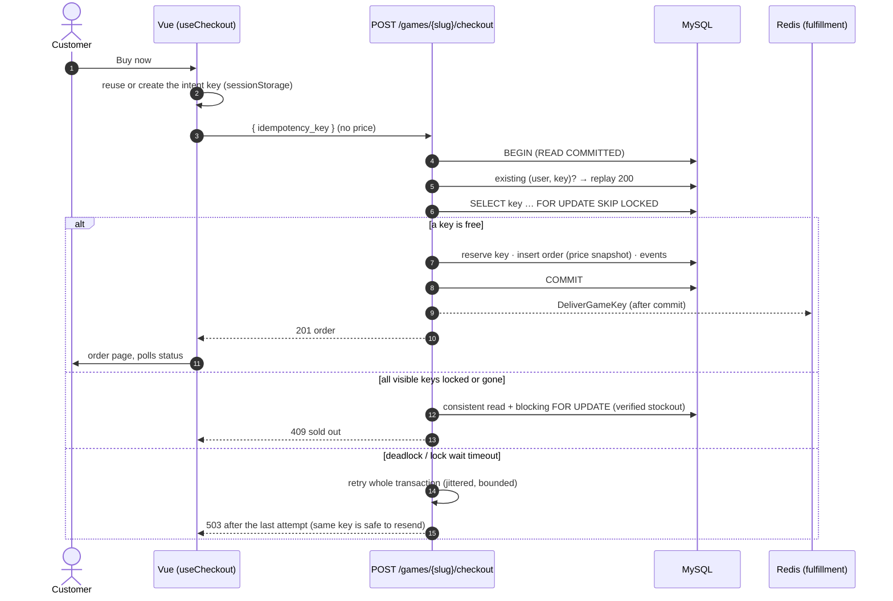
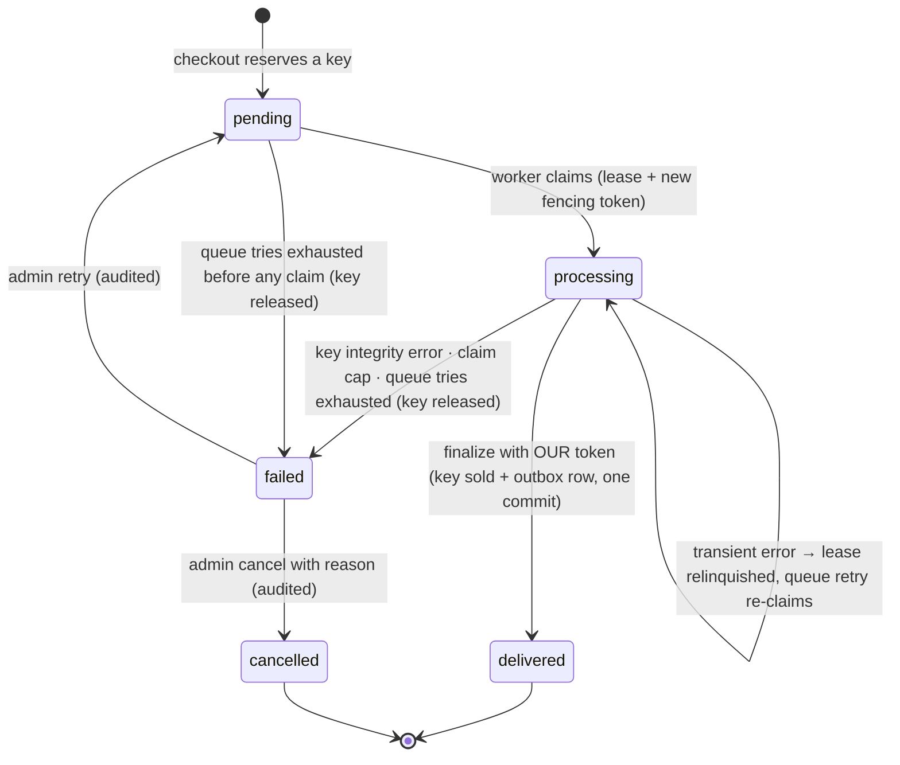
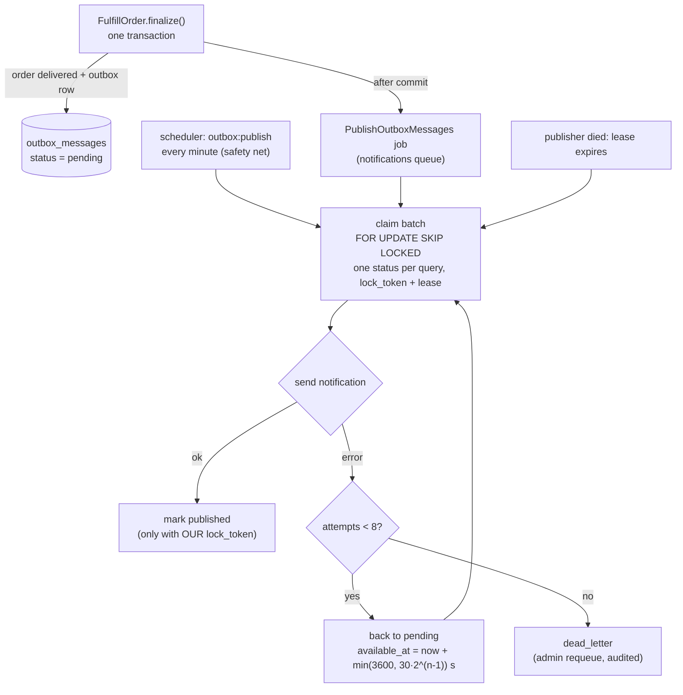

# Engineering deep dive

How GameVault keeps its promises under concurrency and failure: the checkout sequence, inventory
consistency, the fulfillment lifecycle, the transactional outbox, the security model and the
trade-offs behind them. These sections moved here from the README unchanged; the full list of
guarantees with their measurements and crash analysis is in [architecture.md](architecture.md),
and each key decision has an [architecture decision record](adr/README.md).

## Checkout sequence

## Inventory consistency design

- **One intent, one order.** `UNIQUE(user_id, idempotency_key)` plus a request fingerprint: a replay returns the committed order (200), a reused key for a different game is a 422, never a second purchase.
- **Reservation without false stockouts.** Buyers take a free key with `FOR UPDATE SKIP LOCKED`, so they do not queue behind each other. Skipping locked rows can make a buyer *believe* stock is gone while another buyer's transaction might still roll back, so "sold out" is only answered after a verified stockout (consistent read, then a blocking `FOR UPDATE`): nobody is told "sold out" while a key could still become theirs.
- **Isolation and plans.** READ COMMITTED (no gap locks on the hot path), a 5 s lock-wait timeout, index-pinned locking reads, and whole-transaction retries with jitter; exhaustion is a retryable 503.
- **The database has the last word.** 17 CHECK constraints and composite foreign keys reject impossible states (a sold key without an order, an order holding another title's key, ...), independently of application code.
- **Proven with real processes.** The concurrency tests start independent PHP processes, each with its own MySQL connection, release them through a barrier and assert commit ordering, not timing. The load test below repeats the race over HTTP and then checks the database.

## Queue fulfillment lifecycle

Three short steps, so no transaction is ever open during slow work: **claim** (lock the order,
take a lease with a fresh fencing token), **provision** (no transaction; the supplier hand-off),
**finalize** (only if the order still carries *our* token). A duplicate job is a no-op, a crashed
worker's lease expires and is taken over, and a slow worker that lost its lease cannot finalize.
`DeliverGameKey` retries transient failures 5 times with backoff 5/15/45/135 s; its timeout (30 s)
stays below the lease (60 s), which stays below the queue's `retry_after` (90 s), an invariant
pinned by a unit test.

## Transactional outbox design

The delivery e-mail is written in the same commit as the delivery itself, so it can never be lost
or sent for a delivery that rolled back. Delivery to the mailer is at-least-once; the e-mail
contains no key material, only a link to the order.

## Security model

- **Authorization on the server.** Customer order routes are owner-only and answer **404** to anyone else; public ids are ULIDs. The admin area requires `auth` + `can:admin` on every route; Horizon is admin-only in every environment. Admins can retry, cancel, import and requeue, but can **never** reveal a customer's key. The E2E suite also sends crafted requests to prove the UI is not the only barrier.
- **Keys.** Encrypted at rest, fingerprinted for de-duplication, revealed only by an owner's explicit POST (CSRF-protected, rate limited, audited, `no-store`), never placed in Inertia props, listings, e-mails, logs or web storage. A live scan after the E2E and Horizon runs searched every log, failed job, Horizon payload, audit entry, order event and outbox payload for all 124 keys: none found.
- **No privilege escalation.** `is_admin`, status, lease and key linkage are not mass-assignable (strict mode outside production); admin rights are granted only via CLI and audited.
- **Abuse limits.** Checkout and reveal are rate limited per user; the UI explains the wait using `Retry-After`.
- **Errors.** Branded error pages keep the right status; with debug off, 500s expose nothing but a request id. No `v-html` anywhere.
- **Test isolation.** The Pest suite refuses any database but `gamevault_test`; the E2E stack refuses any database not ending in `_e2e` (checked at boot and before `migrate:fresh`).

## Architecture trade-offs

The main ones are written up with their context and consequences in [docs/adr](adr/README.md).

- **Synchronous reservation, asynchronous delivery.** The key is reserved inside the checkout transaction, so "you got it" is decided once, at checkout; only delivery is queued. Cost: checkout holds row locks briefly and needs the stockout verification path.
- **SKIP LOCKED plus verification instead of plain `FOR UPDATE`.** Buyers do not serialise on the first free row, at the price of a second, rarer query when stock looks empty.
- **READ COMMITTED.** Avoids gap-lock deadlocks of REPEATABLE READ on the hot path; correctness comes from explicit row locks and constraints, not from the isolation level.
- **Leases and fencing over "exactly once".** Queues are at-least-once; the business operation is made idempotent instead of trusting the transport.
- **Outbox over "send after commit".** One extra table and a publisher, in exchange for never losing or inventing a notification.
- **Polling over WebSockets.** Bounded, visibility-aware polling of one order is simple and cheap at this scale; push would be the next step under real traffic.
- **Inertia over a separate SPA + API.** One routing and authorization layer, typed props mirrored by `types/models.ts` and pinned by `FrontendContractTest`.
- **Dark-only design.** One carefully tuned theme instead of two half-finished ones.
